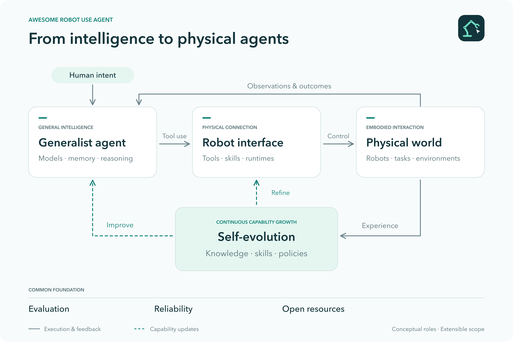

News: We release a benchmark to evaluate the ability of MLLM on the robot use, please see: [RobotWorld](https://robotworldai.github.io/)😙

  

A curated list of research on general-purpose AI agents that perceive, program, and operate robots through tools, interfaces, and reusable skills.

Inspired by Phillip Isola's [Robot-Use Agents](https://web.mit.edu/phillipi/www/writing/robot-use-agents.html). The emphasis is on how general-purpose intelligence can be connected to different robots and how improvements can spread through models, software interfaces, and reusable capabilities.

  

## Contents

- [General-Purpose Robot-Use Agents](#general-purpose-robot-use-agents)
- [Reasoning-Acting and Dual-System Architectures](#reasoning-acting-and-dual-system-architectures)
- [Self-Evolving Robot Agents](#self-evolving-robot-agents)
- [Embodied Agent Operating Systems and Runtimes](#embodied-agent-operating-systems-and-runtimes)
- [Programming and Spatial Action Interfaces](#programming-and-spatial-action-interfaces)
- [Planning, Skill Orchestration and Memory](#planning-skill-orchestration-and-memory)
  - [Task Planning, Skill Orchestration and Memory](#task-planning-skill-orchestration-and-memory)
  - [Safe Planning, Verification and Failure Recovery](#safe-planning-verification-and-failure-recovery)
  - [Multi-Robot Coordination](#multi-robot-coordination)
- [Language-Native Actions and Cross-Embodiment Transfer](#language-native-actions-and-cross-embodiment-transfer)
- [Infrastructure and Benchmarks](#infrastructure-and-benchmarks)
- [Perspectives and Reports](#perspectives-and-reports)

### General-Purpose Robot-Use Agents

General-purpose models operating robots through reusable harnesses, tools, and visual interfaces.
- FORCA: A Force-Aware Coding Agent for Contact-Rich Robot Manipulation — *Writes Python robot programs from language and visual input, uses wrist force/torque feedback during execution, then revises the program from recorded force and visual outcomes; evaluated on five real-robot tasks without demonstrations or task-specific training.*
  
  
- Self-Building Labs — *Given a scientific goal, an AI system configures a laboratory setup by building missing layouts, digital twins, robot skills, and workflows; demonstrated across robot setups and a real quantum-dot synthesis experiment.*
  
  
- CLARO: Clutter Aware Robot Orchestrator for Open-Vocabulary Grasping using VLM Agents — *A VLM agent orchestrates detection, segmentation, grasping, and pushing skills with action memory to retrieve language-specified objects in clutter; reports simulated results and 88.8% success on its real-arm evaluation.*
  
- Embodied Task Agents Can Perform Fine Manipulation through Tactile In-Context Learning (Tactile-ETA) — *Adds aligned visual–tactile demonstrations to a general-purpose robot agent’s context without updating its parameters; reports gains on four simulated tasks and a small set of physical manipulation tasks.*
  
  
- HexaShell: A Thin Harness for Exploring the Limits of VLM Agents as Robot Coding Agents — *A coding agent controls a dual-arm robot through a thin CLI, inspects failures, and writes reusable perception tools; v2 reports 46.9% success on the official hidden-seed benchmark (53.2% progress), while tight insertion remains difficult.*
  
  
  
- RoboHarness: A Simple Harness Outperforms VLA and World Action Models — *Gives a coding agent a visual-geometric control panel for invoking embodied tasks; v2 reports BEHAVIOR Challenge results and says implementation is open source, but the arXiv record does not link the repository.*
  
- Can a Frontier VLM Serve as a Robot Policy for Memory-Dependent Manipulation? — *A frozen frontier VLM controls memory-dependent manipulation through TCP waypoints and gripper commands while retaining visual history; evaluated in simulation with disclosed adaptive development on the test split.*
  
  
  
  
- JoyInside-VLM-Agent: Product-Conditioned Multimodal Policy Learning for Embodied Agents — *Post-trains a multimodal ReAct agent to select tools under product-specific robot capabilities and constraints; evaluates tool decisions and includes selected physical quadruped interaction traces rather than broad robot success-rate testing.*
  
- TacZero: Training-Free Peg Insertion Using a General-Purpose Vision-Language Model with Tactile Feedback — *A pretrained general-purpose VLM interprets visual and tactile feedback to issue end-effector targets for physical peg insertion without additional task training; evaluated after scripted grasp preparation with human-judged outcomes.*
  
- RobotUse: Allocating Computation, Context, and Decisions — *Allocates task intent to a main agent, visual target and pose decisions to subagents, and geometry and control to a robot backend; a persistent playbook supports adaptation from execution experience, with simulation and physical-robot evaluation.*
  
  
  
  
- SuperNav: An Agentic Navigation System for Any Task in Any Scene — *A pretrained multimodal agent uses navigation skills, tools, progress tracking, and a visual-point interface to delegate motion to geometric or learned executors; includes simulated evaluations and quadruped deployment.*
  
  
  
  
- SpatialHarness: Test-Time Spatial Scaffolding for Fine Robotic Manipulation — *Adds synchronized virtual views and structured spatial observations to a frozen multimodal robot policy at test time; evaluated on four physical manipulation tasks with 15 trials per method and task.*
  
- OpenRUA: Robot-Use Agents Are Zero-Shot Visuomotor Policies — *Off-the-shelf coding agents write perception and control programs through native ROS 2 terminal interfaces, with no task-specific policy training; evaluated in simulation with time paused during agent deliberation.*
  
  
  
- RoboICL: Embodied In-Context Learning with GPT-6 Astra — *A frozen general-purpose VLM issues Cartesian action chunks through a validated robot interface, using demonstrations, execution receipts, and observation history for closed-loop correction; simulation and real-robot evaluation.*
  
  
  
- ASENA: Self-evolving Agents for Embodied Navigation — *A general-purpose coding agent navigates through sensor and execution tools while accumulating persistent notes and programs; evaluates repeated-task improvement in simulation and supervised humanoid demonstrations.*
  
  
- MotorMind: Scaffolding General Vision Language Models for Zero-Shot Robot Manipulation — *A frozen general-purpose VLM controls robot manipulation through mid-level actions, asynchronous monitoring, outcome verification, and background memory updates; evaluated in simulation and on an xArm6.*
  
  
- Robot Manipulation with GPT-6-Astra: Body Knowledge, Experience Reuse, Emergent Skills, and Sim2Real Transfer — *Body descriptions and recorded experience support reusable control code and sim-to-real transfer; physical evaluation comprises 12 trials using operator-confirmed button contact.*
  
  
  
- **Know Your Body: A Harness for Direct and Self-Improving Robot Control with VLMs** — KnowBody; body-grounded robot control and iterative improvement through execution feedback, evaluated on a small real-robot task suite.
  
  
- Generalizing Manipulation Skills with a Local Coding Agent — *A local open-weight VLM writes and executes perception and control code for real-world UR3e manipulation, with documented skills and in-session reuse.*
  
  
- AR-WAM: A Visual-Conditioned Agent-Ready World Action Model for Robotic Manipulation — *Agent-ready manipulation through visual grounding, operation tokens, and `detect` / `execute` / `query` interfaces.*
  

- Structured World-State Reasoning for Agentic Robotic Search — *WORLDS maintains a persistent world-state graph and lets agents request, verify, and revise observations before selecting a target.*
  
- Transferring the Intelligence of VLMs to Robotic Control — *RoboDawn*
  
- RoboFind: Multi-Agent Personalized Object Search for People Who Are Blind or Have Low Vision 
  

- Navi-Agent: Unlocalized Monocular Navigation Agent — *Previously reported; coordinate-free spatial memory for closed-loop navigation, progress verification and recovery.*
  

- In-Context Robot Learning with VLM Agents — *GPT-Policy; in-context adaptation without parameter updates.*
  
  
  
  
- WetRobo: A Reproducible Robot Kit for Coding Agents in Biological Laboratories — *Laboratory robotics.*
  
  
  
- HarnessVLN: Unifying Training-Free Embodied Navigation through an Agent Harness — *Navigation.*
  
  
- EMERGE-Policy: A Robot Mind Emerges Beyond a Single Policy
  
  
  
  
- Agent as Policy for Robotic Manipulation
  
  
  
- Show-Harness: Just a VLM Agent Can Play Robots
  
  
  
  
  
  
- VIA: Visual Interface Agent for Robot Control
  
  
  
  
- CaP-X: A Framework for Benchmarking and Improving Coding Agents for Robot Manipulation
  
  
  
  
- Guava: Distilling Frontier VLMs into a Compact Agent through a Robotic Manipulation Harness
  
  
- ETA: A New Agentic Paradigm for Embodied Tasks
  
  
  
  
- Maestro: Orchestrating Robotics Modules with Vision-Language Models for Zero-Shot Generalist Robots
  
  

- ThinkLocoManip: A Whole-Body Control Agentic Harness for Legged Loco-Manipulation — *Interleaves reasoning and action while composing perception, navigation, manipulation, and locomotion tools for long-horizon legged tasks.*
  
- Pretraining Knows What, Simulation Teaches How: Compositional Generalization in a Sim-Trained Robot Agent — *ZAP adapts a pretrained 27B VLM to robot tool use through simulation SFT and GRPO; reports real-world transfer without real-robot training data.*
  
- Agentic World Action Models — *AW-0 couples code-based reusable skill programs with future-video and action prediction, joining agentic planning and physical dynamics in one model.*
  
  
- OmniBrain-0: A Unified Agentic Model for Embodied Intelligence — *A compact learned agent coordinates manipulation and navigation, with a rubric-guided recursive data flywheel and real-world evaluations.*
  
  

### Reasoning-Acting and Dual-System Architectures

Architectures that organize reasoning and robot execution through intermediate plans, coupled reasoning and action modules, or adaptive think/act scheduling. Includes learned-policy building blocks and agent-level systems. For author-described System 1 (e.g., Jev-like system) /System 2 models (VLM-like models), fixed-rate and asynchronous coupling are distinguished from adaptive reasoning. Related task-time memory and recovery methods remain under [Planning, Skill Orchestration and Memory](#planning-skill-orchestration-and-memory).
- Make π0.5 Learn to Call Astra for Reliable Robot Manipulation — *Learns a CALL head on frozen policy features to request a general-purpose model for closed-loop recovery and then hand control back to the robot policy; evaluated on LIBERO with additional consultation cost.*
  
  
- Bridging Frontier Reasoning and Robot Execution: From Autonomous Demonstration Generation to Dense Language Supervision — *Connects frontier-model guidance to a trained local policy through autonomous demonstration collection, corrective examples, and dense language supervision; evaluated in simulation and on physical manipulation tasks.*
  
- Code Owns the Simulation, Jev Owns the Evaluation — *Studies Jev as an evaluator of outcomes supplied by code, combining lookahead and executable skills; includes simulated Stacker control and instruction variants, with action-abstraction differences limiting causal attribution.*
  
- DSWAM: A Dual-System World Action Foundation Model for Fine-Grained Robot Manipulation — *System 1 WAM execution with an optional System 2 subtask planner; video co-training without future-video generation at inference.*
  
  
- Fast-ThinkAct: Efficient Vision-Language-Action Reasoning via Verbalizable Latent Planning — *Preference-guided distillation compresses reasoning into verbalizable latents for action policies; evaluated in simulation and embodied reasoning benchmarks.*
  
  
- ThinkAct: Vision-Language-Action Reasoning via Reinforced Visual Latent Planning — *Action-aligned reinforcement learning connects a vision-language reasoner to a diffusion policy through visual plan latents; simulation evaluation.*
  
  
- Fast-in-Slow: A Dual-System Foundation Model Unifying Fast Manipulation within Slow Reasoning — *Partially shared System 1/System 2 parameters with asynchronous observations and action generation; simulation and real-robot evaluation.*
  
  
  
  
- Agentic Robot: A Brain-Inspired Framework for Vision-Language-Action Models in Embodied Agents — *Planner–executor–verifier coordination with subgoal verification and recovery; evaluated on LIBERO.*
  
  
  
  
- OneTwoVLA: A Unified Vision-Language-Action Model with Adaptive Reasoning — *A unified VLA predicts reasoning or action mode tokens to think at critical moments and otherwise execute action chunks.*
  
  
  
  
- GR00T N1: An Open Foundation Model for Generalist Humanoid Robots — *An Eagle-2 vision-language System 2 conditions a flow-matching System 1 action module, jointly trained across heterogeneous data.*
  
  
  
- Hi Robot: Open-Ended Instruction Following with Hierarchical Vision-Language-Action Models — *A high-level VLM guides a low-level VLA through language; planning refreshes periodically and on user feedback.*
  
  
- Robotic Control via Embodied Chain-of-Thought Reasoning — *ECoT; a VLA reasons about plans, sub-tasks, motion and visually grounded state before predicting robot actions.*
  
  
  
  

### Self-Evolving Robot Agents

Systems that turn experience into reusable knowledge, skill programs, improved policies, or validated capability upgrades. Includes human-guided methods and learned-policy precursors where noted.

#### Memory and Knowledge Evolution
- Spatial Memory by Agents, for Agents — *A coding agent iteratively designs spatial-memory construction and retrieval code using a fixed query agent, then freezes it before held-out evaluation across five memory tasks; reports gains over a broad ReMEmbR baseline, while noting grounding and evidence-use failures.*
  
  
- Externalise the Memory: A Pre-Registered Study of Where an Embodied Agent’s Experience Should Live — *A pre-registered reach-task study finds retrieval memory attached to fixed policy weights helps more than distilling memory-augmented behavior into weights; the registered weight-distillation claim was underpowered and inconclusive.*
  
- FastHarness: Experience-Driven Review Scheduling for Vision-Language-Action Policies — *Adaptively schedules reviewer calls around a frozen VLA policy using experience and execution feedback; reports efficiency and task performance on simulated manipulation, so this is harness adaptation rather than policy training.*
  
  
  
- An Agentic Framework for Proactive Robots with Procedural Assistance Memory — *Maintains a finite-state procedural assistance memory that a VLM revises between days to personalize when and how a robot helps, while a separately trained VLA executes the selected tasks.*
  
  
- ProactiveVLA: Augmenting Embodied Memory through Proactive Environment Exploration — *Uses a reasoning agent and frozen VLA to explore self-proposed goals, verify interactions, and consolidate reusable environment knowledge before evaluation; studies adaptation in simulated manipulation tasks.*
  
- RoboHarn-Evo: Evolving Hierarchical Physical Knowledge for Self-Improving Robotic Manipulation — *A dual-loop manipulation harness evolves persistent task and action knowledge from physical feedback while keeping the base model fixed, supporting retrieval, correction, and reuse across episodes.*
  
- Recursive Harness Distillation across Agents for Robot Manipulation — *A strong agent distills and refines intervention experience into a reusable playbook for lighter agents operating frozen robot policies; evaluated in simulation and real-world manipulation.*
  

- NavHarness: Towards Lifelong Embodied Navigation — *A training-free navigation harness that carries maps, task records, recovery handovers, and consolidated knowledge across reasoning sessions; evaluated in simulated navigation environments.*
  
  
  
- MessyMem: Learning-from-Doing Memory for Mobile Manipulation
  
  
- Robo-Cortex: A Self-Evolving Embodied Agent via Dual-Grain Cognitive Memory and Autonomous Knowledge Induction
  
  
- Distilling and Retrieving Generalizable Knowledge for Robot Manipulation via Language Corrections
  
  
  
  

- ReSight: Task-Driven Self-Improving Memory for Embodied Agents — *Separates execution-time memory queries from coding-agent exploration, distilling discoveries into reusable memory builders, tools, and skills.*
  

#### Skill and Program Evolution
- Compile Once, Run Cheap: Frozen, Portable Skills for Embodied Agents, and What Recursive Self-Improvement Adds — *A strong model authors and repairs skills offline in simulation; frozen executable skills are reused without a frontier model at every run. Skill-RSI reports seven skills across four of seven RoboTwin tasks, but three tasks fail its strict safety gate.*
  
  
- SERA: From VLM Planners to Robotic Agents: Self-Evolving Harnesses for History-Dependent Manipulation — *Evolves contextual memory and execution feedback around a fixed VLA executor, then freezes the harness for held-out evaluation; reports gains on RoboMME, with evidence limited to the benchmark setting.*
  
- Agentic RSR: Real-to-Sim-to-Real through Scene Reconstruction and Execution-Grounded Robot Policies — *A coding agent develops executable manipulation policies through progressively less privileged simulation, then carries the task interface and accumulated experience onto the real robot; the arXiv v2 appeared during this window, while code is still described as forthcoming.*
  
- Agentic Robot Creation through Generation, Verification, and Revision — *Roboforge turns task specifications into executable policies and revises motions or rewards from rollout feedback; includes a fabricated agent-generated robot with physical deployment.*
  
  
- EmbodiedEvo: Self-Evolving Coding Agent For Physical Intelligence — *Distills a coding agent’s robot experience into reusable executable skills and diagnostic lessons, acquired on one playground scene per task and frozen for agents acting in new scenes; evaluated on RoboDojo-Sim.*
  
  
  
- EnactOpt: Diagnosis-Guided Harness Evolution for Embodied Agents — *Uses execution diagnoses to jointly revise textual skills and executable context-management logic around frozen models; independently evolved harnesses are evaluated on embodied and text-based task benchmarks.*
  
- Fly-by-Code: Embodied Coding Agents for Aerial Manipulation with Active Visual and Physical Feedback — *A coding agent refines aerial-manipulation programs using separate diagnostic programs that gather active visual and physical evidence in simulation; shared APIs support subsequent physical execution.*
  
  
- EMHO: EMbodied Agent Harness Optimization via Experience Traces — *Revises planning, context construction, visual tool use, and recovery logic from execution traces while keeping the embodied model frozen; evaluates harness evolution on simulated EmbodiedBench tasks and reports held-out overfitting in later iterations.*
  
  
- RoboRSI: Stable, Efficient, and Reusable Robot Self-Evolution in Complex Real-World Environments — *Human-guided skill-tree refinement attributes failures, revises scoped capabilities, and validates reusable skills; includes 104 evolving real-robot development rounds and simulation benchmarks.*
  
  
  
  
- Embodied Turing Machines: Stateful Code for Robot Recursive Self-Improvement — *Coding agents develop a shared library of stateful robot programs from execution feedback; the resulting code-only policies run without VLM or VLA calls at test time, evaluated on simulated bimanual tasks.*
  
- RoboBridge: A Self-Evolving Embodied Agent Framework for Sim-to-Real Transfer — *Transfers revisable procedural skills from simulation to physical tasks and validates further skill updates from execution feedback, exposing a frozen VLA as a tool with optional inference-time guidance.*
  
- Skill2Real: Agentic Skill Learning for Zero-Shot Sim-to-Real Robot Manipulation — *Learns hierarchical executable skills through a shared robot API using simulation diagnosis and validation gates, then transfers frozen skill memories to a physical UR5e without target-task policy fine-tuning.*
  
- InterEvolve: Test-Time Evolution of Reward Programs for Humanoid Loco-Manipulation — *An LLM evolves staged reward programs using simulation feedback and a verified skill library, while numerical search tunes constants for a fixed pretrained humanoid controller; includes physical G1 deployment.*
  
  
- Reconstruct, Practice, Go Real: Guided Self-Improvement for Embodied Agents — *Improves a persistent skill library and system prompt through simulation practice, privileged failure diagnosis, and cross-task validation, then freezes the calibrated system for physical deployment.*
  
  
- RoboRSI: Stable, Efficient, and Reusable Robot Self-Evolution in Complex Real-World Environments — *Research blog and open-source harness; multiple agents refine a task–skill tree from execution feedback, consolidate workflows into code, and gate skill changes with regression checks.*
  
  
  
- SimEX: Simulation-Integrated Robotics AutoResearch — *A coding agent develops reusable robot toolboxes in simulation and uses limited real-world trials to repair both tools and simulators; demonstrated on three bimanual task families.*
  
  
- Explore, Execute, Evolve: A Skill Acquisition and Reuse Loop for Embodied Agents — *RoboSkill; an exploration–execution–evolution loop accumulates reusable textual and executable skills from robot experience, with visual and tactile feedback and cross-agent skill reuse.*
  
  
  
- Self-Evolving Coding Agents: From Digital Programs to Physical-World Intelligence — *HexaAnything; executable world state and control workflows support tool-based robot execution, tool refinement, and trace-based model training; includes simulation and physical-robot studies.*
  

- RoboFoundry: System-as-Policy Evolution for Self-Learning Embodied Agents — *Evolves context management, persistent memory, and hierarchical skills through validated execution-driven system edits while keeping the foundation model frozen; includes physical robot evaluation.*
  
  
- HarnessPAI: An Evolving Harness for Physical AI — Coding agents refine executable robot harnesses between rollouts using execution feedback, while keeping the underlying action backends frozen.
  

- RACaP: Agentic Reasoning, Acting, and Coding as Policies for Evolvable Robot Learning — Combines reasoning, acting, and code evolution to build reusable robot APIs and harness memory; evaluated in simulation.
  

- AdaHVLA: Adaptive Harnesses for Long-Horizon Vision-Language-Action Execution — Refines code-based coordination between reasoning agents and frozen VLAs through rollout evidence and persistent revision memory; simulation benchmarks and a real-world quadruped deployment case.
  
  
  
- Learning and Transferring Closed-Loop Robot Software — *Coding-agent optimization and reuse of closed-loop robot programs in simulation.*
  
- Self-Evolving Embodied Agents via Skill-Harness Evolution — *SHAPER; frozen-model skill and harness optimization.*
  
- ASPIRE: Agentic /Skills Discovery for Robotics
  
  
  
  
- Lifelong Robot Library Learning: Bootstrapping Composable and Generalizable Skills for Embodied Control with Language Models
  
  
- Eureka: Human-Level Reward Design via Coding Large Language Models
  
  
  
  
- DrEureka: Language Model Guided Sim-To-Real Transfer
  
  
  
  

- MOTIO: Agentic Skill Engineering for Reality-Grounded Humanoid Loco-Manipulation — *Turns videos, 3D assets, motion references, and reusable interfaces into executable humanoid skills refined through simulation, physical feedback, and human approval.*
  
  

#### Autonomous Data Collection and Policy Improvement
- Where is Physical RSI capability from? An Observational Scaling Law of LLM-as-policy — *Introduces PhysRSI-eval across 18 manipulation tasks and analyzes first-attempt performance, efficiency, success, budget, and improvement from failure; workspace interventions suggest persistent interaction history and reusable experience can support later and cross-task gains.*
  
- Scaling Online Exploration for Robot Agents — *RAX uses a frozen general-purpose coding agent to learn from online robot exploration and compile verified skills into executable programs; reports multi-embodiment simulation and physical-robot tasks, with an open harness and skill library.*
  
  
  
  
- D-World: An Explicit World-Language-Action Model with Recursive Self-Improvement under Dual Control — *Separate perception and planning agents write and revise an executable digital twin from measured robot feedback; dual-arm towel and toaster tasks illustrate local, measurement-checked revisions while the LLM remains frozen.*
  
- AdaRSI: On-Demand Recursive Self-Improvement for Embodied Agents — *A coding agent first revises its robot harness, then diagnoses persistent failures through saved-state retries and selectively fine-tunes missing executor skills using self-collected demonstrations; simulation evaluation.*
  
- EndoRSI: Physical-Evidence-Driven Recursive Improvement of Endoscopic Robot Policies — *Uses a coding-agent research loop to revise endoscopic robot policies from physical experiments, failure evidence, and new supervision; evaluation includes benchtop and ex vivo studies under human-authorized execution.*
  
- EmbodiedSmith: Scaling Embodied Data through Recursive Self-Improvement Flywheel in Simulation — *Uses agents to compose skill graphs and iteratively refine simulated scenes, placements, and execution plans for robot data generation, then trains downstream policies on accepted trajectories; improvements are task-dependent.*
  
- EmbodiRSI: Recursive Self-Improvement for Data-Efficient Robot Adaptation — *Coordinates agent-assisted correction and adaptive data collection in task-specific simulations to improve robot policies, followed by limited human-in-the-loop physical refinement and policy-only deployment.*
  
- Co-Evolving Robot Orchestrators and Policies through Deployment — *Co-evolves a VLM orchestrator and robot policy using curated deployment experience, skill-level candidate verification, and rollback; evaluates frozen policy and memory on held-out simulated and physical tasks.*
  
- Find Something You Can't Do: Agentic Real-World Reinforcement Learning for Self-Improving VLA Models — *A vision-language agent selects feasible practice tasks and evaluates outcomes in a persistent workspace, driving residual reinforcement learning over a frozen VLA with reduced manual resets.*
  
- MobiAgent: Dual-Loop Recursive Policy Self-Improvement for Long-Horizon Mobile Manipulation — *A VLM planner and visual critic compose reusable skill policies, while an offline outer loop segments, verifies, and recycles deployment trajectories to fine-tune the skill library.*
  
- SkillWeaver: Agentic Exploration over Neural Interaction Skills for Scalable Robot Data Generation — *A VLM agent composes reusable closed-loop neural interaction skills through verifier-guided exploration, reflection, and memory to generate simulated robot demonstrations for downstream policy learning.*
  
- KnowDemo: Knowledge-Guided Robot Demonstration Generation from Human Videos — *VLM-based task-knowledge extraction for generating diverse, validated robot demonstrations.*
  
  
- MAGMA-GEN: Validated Recovery Supervision from Ambiguous Failures via Counterfactual Re-Execution — *Simulation-validated recovery data for fine-tuning tool-using robot language policies.*
  
  
  
- RoboClaw: An Agentic Framework for Scalable Long-Horizon Robotic Tasks
  
  
  
  
- Zero2Skill: Bootstrapping Robot Skills through Autonomous Data Collection, Training, and Deployment
  
  
  
  
- ENPIRE: Agentic Robot Policy Self-Improvement in the Real World — *Coding-agent-driven real-world policy and algorithm improvement.*
  
  
  
  
- HARBOR: A Harness Framework for Agentic Robot Reinforcement Learning
  
  
  
  
- AutoRT: Embodied Foundation Models for Large Scale Orchestration of Robotic Agents
  
  
- Autonomous Improvement of Instruction Following Skills via Foundation Models
  
  
  
  
- RoboCat: A Self-Improving Generalist Agent for Robotic Manipulation
  
  
- RISE: Self-Improving Robot Policy with Compositional World Model
  
  
  
  
- AllDayNav: Lifelong Navigation via Real-World Reinforcement Learning
  
  

#### Capability Upgrades and Regression Control
- AgenticRoboRL: Training Robot Planners through Harnesses with Multi-Turn Reinforcement Learning — *Trains a planner through robot harnesses while freezing execution; v2 reports LIBERO-PRO success improving from 18.1% to 71.0% for a 9B model, with code/checkpoints still forthcoming.*
  
- Scale and Selection: What Makes Automatic Harness Evolution Work for Visual-Interface Robot Agents — *Studies rollout scale and matched champion–challenger selection for agent-driven evolution of visual robot harnesses, measuring generalization to held-out simulated tasks.*
  
- DynaHarness: A Dynamic Physical Harness for Self-Evolving Robot Agents — *A semantic planner and deterministic execution governor share contracts for refusal, substitution, and recovery, with evidence-based failure attribution and regression-gated capability updates around a frozen policy.*
  
  
- Learning Without Losing Identity: Capability Evolution for Embodied Agents
  
  
  
  
- Governed Capability Evolution: Lifecycle-Time Compatibility Checking and Rollback for AI-Component-Based Systems, with Embodied Agents as Case Study
  
  
  
  

Related system-level memory and learning mechanisms: [PhyAgentOS, ABot-Claw, and WCM](#embodied-agent-operating-systems-and-runtimes). Execution-time recovery methods are listed under [Safe Planning, Verification and Failure Recovery](#safe-planning-verification-and-failure-recovery).

- VISTA: Active Exploration for Self-Improvement in Embodied Agents — *A meta-agent actively tests harness revisions in the environment and tracks version lineage while model parameters remain fixed.*
  
  
  
- RoboDoctor: Training-Free Recursive Self-Improvement for Robot Policies — *Uses execution feedback to revise the harness, intervention policy, and physical operating methods while retaining linked experience across episodes.*
  

### Embodied Agent Operating Systems and Runtimes
- CARE: Know When to Escalate: Critic-Guided Adaptive Execution for Cloud-Local Embodied Agents — *A lightweight critic escalates unreliable local execution to a stronger cloud agent and shares handoff memory; reports improvements across embodied benchmarks, with latency and model-cost trade-offs to consider.*
  

Persistent embodied-agent systems that organize robot capabilities, state, resources, execution checks, and feedback across tasks or robots.
- InstAgent: A Recursively Self-Improving Agent Operating System for Heterogeneous Robot Collaboration — *Organizes collaboration as behavior trees with capability assignment, dependency and handoff checks; retains feedback-driven program revisions and shared spatiotemporal memory, evaluated on 20 real-world multi-robot tasks.*
  
- BT-Agent: Deploying Onboard Robot Agents with Behavior Trees and Multi-Fidelity Evaluation — *Deploys an onboard language-model agent that selects predefined behavior-tree skills with structured execution feedback and local interruption checks; evaluated through text, simulation, and supervised physical-robot trials.*
  
- From Social Reasoning to Embodied Interaction: An Agentic Framework for Social Robots — *Connects multimodal social reasoning and long-term memory to Sophia’s native gestures, speech, and facial actuators through streaming orchestration; evaluated with participant ratings and latency measurements.*
  
  
- NavGPT-3: Harnessing Context in a Hierarchical Navigation Runtime — *Connects language-model planning, a trained navigation VLA, and monitoring through a hierarchical runtime with separate contexts and motion permissions; evaluated in navigation benchmarks and physical interruption studies.*
  
  
  
  
  
- RegenHarness: A Robot Agent Harness with Evidence-Gated Recursive Self-Improvement — *Evidence-gated skill execution, versioned task state, bounded recovery, and a protocol for regression-checked harness configuration updates; demonstrated through quadruped inspection cases.*
  
- NIMO Controller: a self-driving laboratory orchestrator based on the Model Context Protocol — *MCP-based tool discovery and experimental workflow orchestration for AI agents and human users in self-driving laboratories.*
  
  
  
- Retriever: Composing the Perception-Reasoning-Action Loop for Long-Horizon Manipulation — *Asynchronous runtime and deterministic replay.*
  
  
  
  
- Harness Robotic OS: A Unified Embodied-Agent Runtime for Closed-Loop Quadruped Inspection
  
- PhyAgentOS: A Self-Evolving Operating System for Embodied Agents with Decoupled Cognitive Planning and Physical Execution
  
  
  
  
- RoboOS: A Hierarchical Embodied Framework for Cross-Embodiment and Multi-Agent Collaboration
  
  
  
  
- ROSClaw: An OpenClaw ROS 2 Framework for Agentic Robot Control and Interaction
  
- ABot-Claw: A Foundation for Persistent, Cooperative, and Self-Evolving Robotic Agents
  
  
  
- AEROS: A Single-Agent Operating Architecture with Embodied Capability Modules
  
  
  
  
- HoloAgent-0: A Unified Embodied Agent Framework with 3D Spatial Memory
  
  
  
  
- EmbodiedSkills: A Unified Framework for Orchestrating, Training, and Deploying VLA Agents
  
  
  
- WCM: World-Cognition Model for Generalizable Human-Robot Interaction
  
- EMOS: Embodiment-aware Heterogeneous Multi-robot Operating System with LLM Agents
  
  
  
  

### Programming and Spatial Action Interfaces
- Natural-Language to Nav2: Operational Policies for Costmap-Based Navigation — *A local LLM maps operator instructions to explicit, validated JSON policies that Nav2 applies through costmap plugins; evaluated in Gazebo and on TurtleBot3, with policy interpretation errors and validator safeguards documented.*
  
  
  
- Multi-Tool Selection for Robotic Systems: Comparing Semantic Retrieval and LLM — *Compares retrieval and LLM routing for selecting executable robot capabilities from natural-language requests; evaluation uses 164 annotated prompts, so it tests tool selection rather than closed-loop robot task success.*
  
- MoCaP: Mobile Code-as-Policies for Zero-Shot Mobile Manipulation from Passive Human Videos — *Extracts spatial memory and approach priors from passive human video, then uses a code-as-policy agent and robot-specific navigation and manipulation tools for closed-loop mobile manipulation on physical hardware.*
  
  
  
  
- VLMs are Native Action Models: Unleashing the Manipulation Capabilities of VLMs with Explicit Action-Space Grounding — *Grounds VLM-generated textual pose actions with an explicit tool-center-point frame and visual action-space cues, studying both zero-shot control and task-specific post-training in simulated and physical manipulation.*
  
- PhysCaP: Grounding Code-as-Policy Agent with Physics-Informed Exploration — *Augments code-as-policy agents with proprioception-based mass and stiffness measurement tools, using a Planner and Prioritizer to acquire task-relevant physical evidence; evaluated on physical tabletop tasks and in simulation.*
  
  
- Robotic Long-Horizon Manipulation with Progressive In-Context Code Generation and Episodic Feedback — *Generates executable robot plans from progressively organized in-context examples and uses episodic visual feedback for replanning; evaluated in simulation with four physical tabletop demonstrations.*
  
- Fewer Tokens, Better Action: GPT-6 Astra Robot Agents with 14% Higher Success Rate but 65% Fewer Tokens — *An interactive Python interface composes robot primitives and VLA policies with conditional checks, local retries, and selective feedback; evaluated against tool calling on 700 paired simulated task instances.*
  
  
  
- InCoRo: In-Context Learning for Robotics Control with Feedback Loops — *An off-the-shelf LLM updates robot commands from scene-state feedback and in-context examples; demonstrated on physical SCARA and DELTA robots in static and dynamic environments.*
  
- Make Code as Policy Great Again: Frontier Agents Write, Call, and Evolve Robot Tools — *URAI; programming agents develop reusable robot tools with execution feedback and human guidance, while execution agents call validated tools for simulated and real bimanual tasks.*
  
- KPI: A Promptable Kernel for Physical Interaction on Humanoids — *A vision-language agent specifies reference trajectories and interaction contracts for a contact-control kernel above an unchanged whole-body tracker; demonstrated on instruction-driven humanoid interaction tasks.*
  
  

- Encore: Few-Shot Agentic Discovery of Manipulation Strategies — *A coding agent reads structured demonstration evidence, develops policy programs through a fixed perception-and-action API, and freezes them for held-out evaluation; includes two bimanual real-robot tasks.*
  
  
  
- CognitiveReality: Robot-Agnostic Semantic Gaussian Mapping with an LLM Agent for Immersive Collaborative VR Teleoperation — *An LLM routes language and spatial references to typed tools and robot missions over a shared semantic map, with operator confirmation and physical quadruped evaluation.*
  

- **RAPID: Robot Agentic Programming from Demonstrations** — Converts visual demonstrations into robot programs through task specifications, reusable primitives, and interactive verification.
  

- **Coding Agents for Generalized Task and Motion Planning Problems** — Coding agents synthesize reusable planning programs for simulated environments; held-out evaluation executes fixed programs without test-time LLM calls.
  
  
  
  
- ManiSkillFormer: Demonstration-Free Compositional Manipulation via Geometric Contracts and Agentic Skill Graph
  
  
- AntiGrounding: Executable Robot Trajectories as Visual Prompts for VLM-Guided Manipulation — *VLM selection of executable trajectories through a visual interface and an initialized digital twin.*
  
- Auto-HSI: Personalized human control of a robot swarm on demand by using LLMs for online automatic code generation — *Human-in-the-loop interface.*
  
- KINO: A Keyframe Interface for VLM Planning and Whole-Body Control in Humanoid Loco-Manipulation — *Learned low-level controller.*
  
- AnchorVLN: Geometry-Anchored Vision-Language Grounding Reasoning for Open-Vocabulary Navigation
  
  
  
- GTA-2: A Multi-VLM Framework for Synthesizing Robot Manipulation Skills via Grounded Task Axes
  
  
- Evolve Vision-Language-Action Model into an Agent with On-the-fly Tool-use
  
- Code as Policies: Language Model Programs for Embodied Control
  
  
  
  
- ProgPrompt: Generating Situated Robot Task Plans using Large Language Models
  
  
  
  
- ChatGPT for Robotics: Design Principles and Model Abilities
  
  
  
  
- VoxPoser: Composable 3D Value Maps for Robotic Manipulation with Language Models
  
  
  
  
- ReKep: Spatio-Temporal Reasoning of Relational Keypoint Constraints for Robotic Manipulation
  
  
  
  
- PIVOT: Iterative Visual Prompting Elicits Actionable Knowledge for VLMs
  
  
  
- MOKA: Open-World Robotic Manipulation through Mark-Based Visual Prompting
  
  
  
  
- SoFar: Language-Grounded Orientation Bridges Spatial Reasoning and Object Manipulation
  
  
  
  
  
- LangNav: Language as a Perceptual Representation for Navigation
  
  
  
  
- LM-Nav: Robotic Navigation with Large Pre-Trained Models of Language, Vision, and Action
  
  
  
  
- Language to Rewards for Robotic Skill Synthesis
  
  
  
  
- Trust the PRoC3S: Solving Long-Horizon Robotics Problems with LLMs and Constraint Satisfaction
  
  
  
  

### Planning, Skill Orchestration and Memory

Agents that select and coordinate robot capabilities, track state, verify outcomes, and recover from failures.

#### Task Planning, Skill Orchestration and Memory
- Plan First, Act Later: Streaming Reasoning for Executable Memory in Robot Control (PAL) — *Streams visual evidence into semantic-event memory and an executable subtask list for a VLM planner and low-level VLA; reports 56.05% on RoboMME and 60.83% across four real-world manipulation tasks.*
  
  
  

Task decomposition, reusable skill orchestration, and task-time memory. Includes learned hierarchical planners and action models where applicable.
- AVALON: Zero-Shot Indoor Navigation with Human-Seeded Topological Memory — *Uses a human-seeded topological map and editable task memory to guide local navigation, verify semantic arrivals, and update physical-state records from robot evidence; evaluated on a quadruped in one office.*
  
- ChunkAct: Action Chunking for Agentic Robotics — *Compiles task knowledge into executable action chunks with typed failure exits, reducing planner calls while retaining feedback-driven replanning; evaluated on simulated manipulation benchmarks.*
  
- Gamma: Grounded Multi-Agent Memory with Mechanical Audit for Memory-Intensive Manipulation — *Combines grounded text memory, separate writer and reasoner agents, and mechanical verification of memory claims to guide a fixed subgoal-conditioned manipulation policy; evaluated in simulation.*
  
  
  
- REMM: Revisable Embodied Memory for Manipulation — *Maintains revisable task state backed by an append-only evidence log, withdraws dependent conclusions, and schedules verified recovery skills around a frozen robot policy; physical trials include operator assistance.*
  
  
- RoboAware: Learning to Coordinate Embodied Skills from Counterfactual Outcomes — *Learns a state-conditioned coordinator from matched counterfactual simulator branches to route between modular skills and frozen end-to-end policies while a frozen coding agent generates local executable programs.*
  
- Proactive Robot Assistance via Event-Driven Reasoning over State Changes — *Triggers VLM reasoning from stable before-and-after scene states to infer assistance needs and select indexed robot primitives; physical tabletop evaluation counts clarification as an appropriate response alongside autonomous assistance.*
  
- OntoPlan: An Ontology-Grounded Scene Representation and Agentic Framework for Scalable Robot Task Planning — *Connects ontology-grounded scene retrieval and goal formalization to a symbolic planner through an agentic workflow; evaluates symbolic task planning in fully specified worlds rather than perception-to-action robot execution.*
  
  
  
- Recursive Video In-Context Learning for Agentic Robot — *Exposes a demonstration as a hierarchy of keyframes, phases, moments, and clips that an agent retrieves through read-only tools while orchestrating a frozen VLA; evaluated on LIBERO in simulation.*
  
  
  
  
- MarvisNav: Making Memory Visible on Route Choices for Zero-Shot Object Navigation — *Projects topological exploration states onto egocentric route choices for VLM-based object navigation, coupling visible memory with sparse high-level decisions; includes simulation evaluation and Go2 deployment demonstrations.*
  
  
- Beyond the Remembered World: Predictive 4D Belief for Persistent Navigation in Evolving Worlds — *A frozen VLM invokes temporal-memory, prediction, inspection, and navigation tools to search for targets whose locations change; evaluated in simulation and matched physical-robot trials, with gains strongest under learnable routines.*
  
  
  
  
- AgenticNav: Zero-Shot Vision-and-Language Navigation as a Tool-Calling Harness — *Exposes pixel-target actions, on-demand depth queries, and selective visual memory recall as tools for a VLM navigation agent; evaluated in VLN-CE and on two physical robot platforms.*
  
- NavHarness: Adaptive Goals for Agentic Vision-Language Navigation — *Four agents coordinate goal generation, verification, memory, and visuomotor execution, compressing navigation history at verified goal boundaries; evaluated on 24 real-robot route trials.*
  
  
- RoboHarness: Memory-Driven Orchestration of Heterogeneous Robot Policies for Long-Horizon Planning — *An agentic orchestration layer exposes heterogeneous robot policies as reusable skills, using execution evidence and memory to route tasks and bridge policy handoffs without joint retraining; simulation and real-robot evaluation.*
  
  
- Simple Agentic Memory for Generalist Robot Policies — *SimpleARM; a training-free external memory layer maintains task-relevant typed state, retrieves history-dependent information, and re-grounds recalled entities for frozen robot policies; evaluated on RoboMME.*
  
  
- NavJev: Efficient Vision-Language Navigation via Action-Centric Visual Compression and Discriminative Action-Semantic Memory — *Action-centric visual compression and discriminative action-semantic memory support typed Jev decisions for vision-language navigation, evaluated in R2R-CE and two real indoor environments.*
  
  
Cross-cutting reasoning/action coupling and System 1/System 2 designs are listed under [Reasoning-Acting and Dual-System Architectures](#reasoning-acting-and-dual-system-architectures).
- Actively Resolving Contextual Uncertainty for Underspecified Tasks in Natural Language — *CLUE; an LLM agent resolves ambiguous goals through map queries, inspection, navigation, and manipulation skills, with closed-loop evaluation on a physical Spot robot.*
  
  
- NavProbe: Evidence-Grounded Reasoning with Active Memory Retrieval for Zero-Shot Navigation — *A hierarchical VLM navigation agent that retrieves visual and geometric evidence to revise subgoals and select parameterized navigation skills.*
  
- World Action Planner: Generalizable Decision-Making with Action-Conditioned World Models — *VLM action plans are refined through action-conditioned world-model imagination, optimization and search; simulation evaluation.*
  
  
  
  
- MistyPilot: Enabling Social-Robot Control through Multi-Agent LLM Skill Orchestration — *Natural-language skill orchestration, sensor-event binding, and dialogue-state management on a physical social robot.*
  
  
  
  
- Bridging Thought and Action: Taming Long-Horizon Instability in Open-Source LLM Agents with a MetaTool-Enhanced ROS Framework
  
- 2AM: Grounding Agent-Side Memory as Guidance for Steerable Action Models in Long-Horizon Manipulation
  
- Memory as Plans: World-Action Modeling with Memory-Grounded Planning
  
  
  
  
- Towards Long-horizon Embodied Agents with Tool-Aligned Vision-Language-Action Models
  
- Do As I Can, Not As I Say: Grounding Language in Robotic Affordances
  
  
- SayCanPay: Heuristic Planning with Large Language Models using Learnable Domain Knowledge — *Offline action-sequence search; simulation evaluation.*
  
  
  
  
- Inner Monologue: Embodied Reasoning through Planning with Language Models
  
  
- SayPlan: Grounding Large Language Models using 3D Scene Graphs for Scalable Robot Task Planning
  
  
- RoboStream: Weaving Spatio-Temporal Reasoning with Memory in Vision-Language Models for Robotics
  
  
  
  
- Towards the Harness of Embodied Agents
  
  
  
  
- Harness VLA: Steering Frozen VLAs into Reliable Manipulation Primitives via Memory-Guided Agents
  
  
  
  
- Being-0: A Humanoid Robotic Agent with Vision-Language Models and Modular Skills
  
  
  
  
- MOSAIC: Modular Foundation Models for Assistive and Interactive Cooking
  
  

- Creative Robot Tool Use with Large Language Models — *RoboTool; executable plans over parameterized skills.*
  
  

#### Safe Planning, Verification and Failure Recovery

Methods that assess risks, verify execution, and trigger corrective planning or recovery. Failure-recovery benchmarks are listed under [Infrastructure and Benchmarks](#infrastructure-and-benchmarks).
- CarryOn: A Dual-Loop Harness for Personalized and Reliable Robot Assistance — *Augments a frozen VLA with revisable user and scene memory, geometric action shielding, and reusable recovery skills refined through reflection; evaluated in simulation and targeted physical-robot studies.*
  
  
  
  
- Cracking Mobile Manipulation: From Failure Diagnosis to Agentic Robot System — *Diagnoses long-horizon mobile-manipulation failures and adds demonstration-based skills, adaptive visual memory, base positioning, and end-effector corrections around a fixed subtask VLA; simulation and physical evaluation.*
  
  
  
- ParallelWorld: Test-Time Scaling for Agentic Embodied Reasoning — *Uses verifier-guided search over imagined outcomes of executable primitives, then executes one action and replans; evaluated on embodied understanding and simulated manipulation, with additional test-time computation.*
  
  
  
  
- Recova: Agent-Guided Failure Recovery for Autonomous Robotic Manipulation — *An agent develops recovery programs in a digital twin and monitors, restores, verifies, and resumes robot tasks; real-world experience and human demonstrations improve separate task and recovery policies.*
  
  
- FRAMES: Failure Recovery And Monitoring of Embodied Skills for Humanoid Loco-Manipulation — *A planner, VLM monitor, recovery agent, and memory module form a failure-aware supervisory loop for humanoid skills.*
  
- CommitFlow: Semantic Commitment Verification and Local Correction for Long-Horizon Robot Manipulation VLA Execution — *Frozen-policy execution harness with semantic commitment monitoring, local correction and stage-level verification.*
  

- When Should a Failing Robot Ask? Initiating Corrective Human-Robot Dialogue from Audited Sensor Evidence — *Evidence-aware choice between autonomous action, additional sensing and human assistance after failure.*
  

- Coding Agents with an Obstacle-Aware Harness for Safe Robot Manipulation — *SafeHarness; obstacle-aware route verification, replanning, and contact execution, evaluated in simulation.*
  
- GAVEL: Graph World Models for Verified and Efficient Long-Horizon LLM Task Planning 
  
- Safe Task Planning with Long-Term Graph Memory for Embodied Agents
  
  
  
  
- VLA-Corrector: Stage-Aware Observable State Understanding for Prompt-Based Closed-Loop Recovery of Vision-Language-Action Policies
  
- CoPAL: Corrective Planning of Robot Actions with Large Language Models
  
  
  
  
- REFLECT: Summarizing Robot Experiences for Failure Explanation and Correction
  
  
  
  
- DoReMi: Grounding Language Model by Detecting and Recovering from Plan-Execution Misalignment
  
  
- AHA: A Vision-Language-Model for Detecting and Reasoning Over Failures in Robotic Manipulation
  
  
  
  

- Robots That Ask For Help: Uncertainty Alignment for Large Language Model Planners — *KnowNo; calibrated uncertainty and human clarification.*
  
  
  

- RoboDuo: Attempt, Check and Atomic Recovery through Code for Vision-Language-Action Models — *A coding agent checks full-task VLA completion and delegates remaining atomic steps to a second VLA; the agent itself emits no robot actions.*
  
- RetroNav: Scene-Grounded Retrospection and Retry for Self-Evolving Lifelong Navigation — *Grounds retry briefs in accumulated scene evidence and prior navigation episodes; arXiv says the code will be released.*
  
- Which Hand Was Late? Diagnosis for Robot Failure Recovery in Bimanual Tool Use — *Studies what sensing can identify about bimanual failures and uses an escalation-based repair policy; evaluated in simulation.*
  
- Refuses When Asked, Complies When Acting: A Runtime Safety Check for Robot Control Loops — *Adds a pre-motion hazard check to a tool-driven robot harness; small physical study found hazardous instructions were blocked in 15/15 trials.*
  

#### Multi-Robot Coordination
- UAV-SwarmAgent: Scalable Multi-UAV Reconnaissance and Task Allocation via Code Generation and Vision-Language Reasoning — *A ground-station agent converts a natural-language mission into executable per-UAV routes, assigns work by route cost, and dispatches worker agents for incident verification; simulation reports 244/255 detections and a speedup capped at 1.52× for five UAVs.*
  
- Policy Search in Code Space for Multi-Agent Pathfinding — *Human-directed coding agents propose, implement, test, and verify policy code in simulation; v2 reports higher performance on MAPF and warehouse throughput, an offline algorithm-discovery workflow rather than inference-time robot control.*
  
- CoEvolve: Self-Evolving Code Policies from Skills to Strategies for Humanoid Robots — *Evolves executable coordination code over fixed motor skills using physical verification and retained experience; reports 8 completed tasks across 15 base runs with two simulated Unitree G1 robots, while contact stability remains limited.*
  

Task allocation, communication, and organizational structures for teams of robots or embodied agents. ORCH is evaluated in simulation; system-level runtimes are listed under [Embodied Agent Operating Systems and Runtimes](#embodied-agent-operating-systems-and-runtimes).
- Persistent LLM Orchestration of Heterogeneous Robot Teams via Partial Delegation to Multi-Agent Protocols — *Maintains a compact semantic world state and delegates routine coordination to multi-agent protocols while selectively re-engaging an LLM for changing rescue tasks; evaluated in abstract heterogeneous-team simulations.*
  
- Verifier-Mediated Multi-LLM Coordination for Multi-Robot Path Planning — *Coordinates robot-specific language-model plans through geometric conflict checks and structured replanning feedback; studied in CARLA scenarios with a physical quadrotor demonstration.*
  
- Managing Context and Communication in Distributed Agentic UAV Swarms — *Combines local language-model agents, structured note memory, and deterministic interest-aware gossip for distributed UAV coordination; evaluated with ten UAVs in simulated search and rescue.*
  
- DuoMind: Enabling Distributed Multi-Robot Coordination with Semantic Communication — *Distributed VLM orchestrators exchange semantic messages and guide fine-tuned VLA controllers through language, evaluated on two-agent RoboPoly and RoboTwin manipulation tasks in simulation.*
  
  
  
- Systematic Multi-Agent Vision-and-Language Navigation: Formulation, Benchmark, and Method — *MAVLN and TRISS; constrained multi-agent navigation with an LLM subtask scheduler, shared topological memory, and conflict-aware execution, evaluated in simulated scenes.*
  
  
- AeroWeaver: An Embodied-Agent Harness for Weaving Aerial Skills into Distributed, Adaptive Swarm Execution — *Simulation.*
  
  
  
- ORCH: Organizational Principles Enable Collective Intelligence in Embodied AI
  
- RoCo: Dialectic Multi-Robot Collaboration with Large Language Models
  
  
  
  
- SMART-LLM: Smart Multi-Agent Robot Task Planning using Large Language Models
  
  
  
  

### Language-Native Actions and Cross-Embodiment Transfer

Related learned-policy methods that preserve language interfaces or reduce adaptation to new embodiments; these generally involve robotics training.

- Actions as Language: Fine-Tuning VLMs into VLAs Without Catastrophic Forgetting
  
  
  
  
  
- LAP: Language-Action Pre-Training Enables Zero-shot Cross-Embodiment Transfer
  
  
  
  
  
  
- VLA-0: Building State-of-the-Art VLAs with Zero Modification
  
  
  
  
  
- LLARVA: Vision-Action Instruction Tuning Enhances Robot Learning
  
  
  
  
- LLaRA: Supercharging Robot Learning Data for Vision-Language Policy
  
  
  
  
- CLAP: Direct VLM-to-VLA Adaptation via Language-Action Grounding
  
  
- RT-H: Action Hierarchies Using Language
  
  
- RT-2: Vision-Language-Action Models Transfer Web Knowledge to Robotic Control
  
  
- In-Context World Modeling for Robotic Control
  

### Infrastructure and Benchmarks
- WorldMirror: Agentic Real-to-Sim Generation of Interactive Worlds from In-the-Wild Robot Demonstrations — *A coding agent orchestrates scene and 3D-generation tools to build an executable world program, then uses verification feedback to refine interactive digital twins and replay recorded robot trajectories; evaluated on DROID demonstrations.*
  
- JARVIS: From Visual Manuals to Autonomous Robotic Assembly — *A benchmark for interpreting visual assembly manuals and executing long-horizon procedures; JARVIS-agentic composes robot primitives into executable programs with feedback-based verification and recovery, without task-specific trajectories or parameter updates.*
  
- Alpha: Systematic Fault Injection and Robustness Evaluation for LLM-Driven Embodied Manipulation — *Injects perception, actuation, kinematic, and planner-output faults to distinguish physical failures from planner/interface errors; a 150-episode simulation study found the measured LLM gap came from output corruption, not the matched physical/kinematic faults.*
  
  
- Embodied Playground: A Long-Horizon Agentic Robotics Benchmark for Physical, Strategic, and Spatial Reasoning — *Tests the full loop of observation, tool use, control-code generation, and independent success/validity checks across 410 task environments; its EP-100 subset covers five suites and 16 task types.*
  
  
  
- TARSphere: A Robot-Oriented Full-Stack Framework for Long-Horizon Embodied Agents in Evolving Physical and Social Environments — *A full-stack benchmark for embodied agents across evolving physical and social environments, with 360 episodes in 30 indoor scenes; evaluates long-horizon interaction, adaptation, and human coordination while exposing safety and robustness limits.*
  
  
  
- HandsOn: A Large-Scale Simulation Benchmark for Generalizable Dexterous Manipulation — *A cross-embodiment manipulation benchmark that includes prompted GPT-6 with move_eef tool control as a zero-shot baseline (5.2% Core-50 and 1.9% Transfer-16 over 660 trials); most of the paper studies trained policies, and qualitative robot rollouts do not establish broad real-world generalization.*
  
- RoboBugBench: Benchmarking Automated Repair of Real Robot Software Under an Audited Behavioral Oracle — *Tests coding agents on 33 execution-validated ROS 2 defects; simulation behavior rather than unit tests grades repairs, and the authors identify important false-acceptance limits in the shipped oracle.*
  
- System1-Arena: Which Decisions Can Be Left to System 1? — *Evaluates typed-decision models including Jev on static questions and mixed-domain closed loops, with simulated robotics interfaces and a latency-aware protocol; separates local decision accuracy from end-to-end success.*
  
  
  
  
- SEAR: Self-Evolving Agentic Robotics — *A framework and benchmark for code-as-policy, live agent control, and agent-driven policy research, with controls for interaction budgets, repeated attempts, and reusable experience across simulated and physical tasks.*
  
  
  
  
- Towards a Systematic Study of Embodied System 2 over Full Task Execution Cycles — *Studies embodied System 2 across full task cycles using evidence memory, progress verification, and dynamic agendas, with simulation and offline next-action evaluation on recorded robot demonstrations.*
  
  
- Embodied Skill Bench: Benchmarking How Well Agents with Embodied Skills Perform on Physical Tasks — *Benchmarks reusable embodied skills and adaptive delegation in simulated manipulation, including a separate Jev waypoint skill that exposes a success–latency trade-off when paired with a frontier VLM.*
  
  
  
- MAGMA-Bench: Evaluating Long-Horizon Embodied Agents under Dynamic Tasks and Execution Failures — *Benchmarks long-horizon skill-calling agents under changing goals, asynchronous multi-robot execution, and controlled failures using structured task-level simulation; abstracts away raw perception and low-level motor control.*
  
  
  
  
- RESCUE: Is This Alarm Worth Acting On? Counterfactual Evaluation of VLA Runtime Monitors — *Evaluates robot runtime alarms by restoring simulator and policy state and comparing counterfactual interventions, measuring whether acting on an alarm improves outcomes rather than detection accuracy alone.*
  
- EmbodiedCLBench: Evaluating Continual Learning for Self-Evolving Embodied Agents — *Evaluates whether coding-agent harnesses transfer interaction histories or distilled skill summaries from basic to composed tasks on offline embodied state-transition graphs; does not evaluate live physical control or continual weight updates.*
  
  
  
  
- What Should Embodied Agents Remember? Benchmarking and Evaluating Memory Modality for Embodied Agents — *Benchmarks memory representations and their inference costs for embodied agents using fixed observation histories followed by memory-dependent requests; includes limited physical delivery demonstrations.*
  
- BiGym 2.0: Benchmarking Learned and Agent-Developed Policies for Humanoid Household Manipulation — *Benchmarks learned policies and cold-start coding-agent programs on simulated G1 household manipulation under a shared whole-body controller, with 20 tasks and native VR demonstrations; the principal comparison covers nine tasks.*
  
- SharedKV-BT: Node-Local Typed Decisions for Behavior-Tree Agents — *Combines node-local typed candidate scoring with behavior-tree stage gating and external postcondition checks; studies simulated robot manipulation and navigation alongside fixed computer-use tasks, without physical-robot validation.*
  
- RobotWorld: Benchmarking Multimodal Agents for Robot Use Across Diverse Tasks and Embodiments — *Benchmarks multimodal agents through robot interfaces across 84 simulated tasks and diverse embodiments, with explicit interaction budgets and executable success checks; reports outcomes and execution-trace limitations.*
  
  
  
  

Jev+Robot

- robo-jev: A 10 Hz Typed-Decision Layer for Physical Robots — *A typed decision layer with deterministic execution; its R13 simulation audit passed a registered comparison after delegating gripper, path, and force choices to rules, while semantic and stop failures remain.*
  
  

- EmbodiedJev: MuJoCo Robot Decision Workbench — *Browser-based MuJoCo and Franka Panda workbench supporting Jev, Claude, OpenAI-compatible APIs, and local MiniCPM models with visible observe–decide–execute–feedback loops.*
  
  

- RoboJEV: Two-Stage JEV Control of a Franka Panda in MuJoCo — *Two-stage typed decisions for task intent followed by Cartesian motion and gripper commands, evaluated with independent physical success checks.*
  
  

- Jev Robot Control — *Reproducible xArm7 MuJoCo comparison of Jev, GPT-6 Astra, and GPT-4.1 mini with archived trajectories, offline verification, and replay.*
  
  
- robojev: Natural-Language Control of a WidowX AI Arm with Jev Typed Judgments — *A real-hardware prototype using typed Jev decisions to sequence reusable manipulation primitives; reported demonstrations are heavily fitted to one paper cup and one table.*
  
  

Robot integration, deployment, latency, runtime reliability, and evaluation of model-plus-interface systems. Includes benchmarks for memory, safety, and recovery, as well as surveys of robot policy verification.
  - RoboQuest: Generalist Physical Agents that Search, Inspect and Test — *Evaluates information-seeking mobile-manipulation agents on ten simulated search, inspection, and interactive-testing tasks, separating missing evidence and premature commitment from execution failures.*
  
  
  
  
- Are Frontier VLM Agents Ready to Be Robot Generalists? An Empirical Study with the Embodied Agent Arena — *Evaluates seven VLM agents across 1,000 cases spanning geometry, spatial reasoning, affordance, planning, and manipulation, separating local competence from complete task success under source-specific interfaces.*
  
  
  
  
- DrivingBench: Can Vision-Language Models Drive a Toyota Corolla? — *A physical-vehicle benchmark exposing three MCP tools to vision-language models, evaluated at parking-lot speeds with a supervising safety driver and bounded retry attempts.*
  
  
  
  
- LIBERO-Agent: Evaluating General-Purpose Agents for Direct Embodied Manipulation — *An agent-native manipulation benchmark with evaluator-owned state and success checks; the public source release provides the 30-task primary suite, while the broader catalog is reserved for a later release.*
  
  
  
- RLE-Bench: A Qualifying Exam for Coding Agents as Robot Learning Engineers — *Evaluates coding agents across interactive robot control, policy development, perception and estimation, and mechanical design under explicit resource budgets and independent artifact evaluation.*
  
  
  
  
- EmbodiedSWE: Coding Agents for Long Horizon Dexterous Robotics — *A simulation benchmark for coding agents and a pipeline that diversifies verified solutions into demonstrations for robot policy learning.*
  
  
  
  
- From Rollout to Reset: A Graph-Based Harness for Autonomous Long-Horizon Manipulation Evaluation — *HALTER; scene-graph-based evaluation, reset planning, and reset verification on a physical robot.*
  
- VABench: Measuring Embodied Spatial Intelligence through Visual Demonstrations, Active Perception, and Metric Control — *Simulation benchmark for general-purpose MLLMs using active camera control, Cartesian action commands, and execution feedback.*
  
  
  
- Towards Embodied Air-Ground Cooperative Object Search: Benchmark, Dataset and Agentic Method — *AGOS; simulated aerial-ground collaboration.*
  
- FluxVLA Engine: A One-Stop VLA Engineering Platform for Embodied Intelligence — *Engineering platform.*
  
  
  
  
  
- No Free Checker: A Survey of Verifiers for Robot Policies — *Survey.*
  
  
  
  
- EvoNav-Bench: Benchmarking Lifelong Navigation in Evolving Environments
  
- ReactHuman: A Physics-Grounded Benchmark for Human-Like Reactive Decision-Making in Embodied Multimodal LLMs
  
  
- MEMOBench: A Process Level Memory Benchmark for Robotic Manipulation
  
  
  
  
- LIBERO-RECOVER: Beyond Task Success Towards Failure Recovery in Robotic Manipulation Models
  
  
  
  
- Enabling Novel Mission Operations and Interactions with ROSA: The Robot Operating System Agent
  
  
  
- RoboScript: Code Generation for Free-Form Manipulation Tasks across Real and Simulation — *ROS-based deployment and code-generation benchmark.*
  
- SPINE: Bridging the Cyber-Physical Gap with Agentic AI
  
- Harness Engineering for Physical AI: Robot Middleware Is the Harness Layer
  
- Reducing Latency in LLM-Based Natural Language Commands Processing for Robot Navigation
  
- EmbodiedBench: Comprehensive Benchmarking Multi-modal Large Language Models for Vision-Driven Embodied Agents
  
  
  
  
  
- Embodied Agent Interface: Benchmarking LLMs for Embodied Decision Making
  
  
  
  
  
- PARTNR: A Benchmark for Planning and Reasoning in Embodied Multi-agent Tasks
  
  
  
  
  

- RobotAgentBench: Towards Open-world Robot Autonomy — *Evaluates task discovery, contextual reasoning, manipulation, and recovery across 50 household layouts; the benchmark evaluation is simulation-based.*
  
  
  
- EmbodiedLab: Benchmarking Embodied Agents That Act to Know — *A physics-based simulated laboratory benchmark for agents that choose experiments and operate apparatus to discover unknown outcomes.*
  
  
  
- SceneAgent: An Agentic Pipeline from 3D and 4D Captures to Simulation Environments — *Uses simulator inspection and repair to turn static and dynamic captures into interactive, policy-learning scenes; real-robot transfer is preliminary.*
  
- SceneRig: An Agentic System for Simulation-Ready 3D Scene Reconstruction from Single Images — *Uses simulator edit-and-validate loops to produce physically stable scenes from single images; a CoRL 2026 Agentic Robotics Workshop paper.*
  
  

### Perspectives and Reports
- Can AI Agents Help Robotic Engineers? Lessons from Two Focus Days in Industry — *A small industrial case study finds no general productivity gain from AI coding agents in vendor-specific robot programming beyond repetitive-code tasks, and highlights the learning curve and need for domain adaptation.*
  

These are essays, research blogs, and evaluations; they are listed separately from papers.
- The Bitter Lesson Comes to Robotics — *Compares nine frontier multimodal models on six physical manipulation tasks; v2 reports rapid July–October 2026 capability growth while concluding that the systems still miss practical action-budget requirements.*
  
- Has GPT-6-Astra Achieved Embodied Intelligence? — *A v2 report evaluates GPT-6-Astra across 12 benchmarks and eight robot configurations, examining in-context demonstrations, System 2/System 1 harnesses, real-world limits, and benchmark design.*
  
- Toward Recursive Self-Improvement in Physical AI — *A survey separates behavioral gains from genuine improvement of the learning procedure and improver, and proposes controlled two-round tests; it concludes that existing physical studies have not isolated gains attributable to recursion.*
  
  
  
- Multimodal Embodied Agents: A Unified Capability-centric Perspective from Computer-Use to Robot-Use — *Organizes embodied agents around Perceive, Anticipate, Plan, Act, and Verify (PAPAV), comparing computer-use and robot-use systems and auditing benchmark coverage; a useful taxonomy rather than a new method.*
  
  
- Towards Agentic Robots: Model, Data, Environment, and Harness — *A survey organizing agentic robotics across model, data, environment, and harness functions, covering how agents develop robot capabilities and orchestrate their use.*
  
  
  
- Who Improves the Robot? Toward Physical Recursive Self-Improvement — *A survey and perspective distinguishing improvements to robot capabilities from improvements to the improvement process itself, with an emphasis on agent harnesses, verification, and evidence for physical recursive self-improvement.*
  
  
  
- When Faster Decisions Do Not Make Better Agents: An Empirical Study of Jev in Agent Workflows — *An empirical study of Jev-based action selection in text-only ALFWorld and AndroidWorld, separating cheaper decisions from task success, recovery, and cost per successful outcome; no physical-robot experiments.*
  
- Silicon Language: A Robot-Native Knowledge Exchange Framework for Heterogeneous Robots — *Proposes robot-native knowledge packets for cross-embodiment exchange, with an operator-assisted laboratory proof of concept; autonomous fleet exchange and general skill transfer remain unvalidated.*
  
- What Stops Recursive Self-Improvement in Robotics? Lessons from 123 Rounds of Agentic Skill Discovery — *Technical report; a simulation case study of agent-driven skill discovery, exposing perception, evaluation, and memory bottlenecks despite 123 improvement rounds without success on the primary target task.*
  
- Robot-Use Agents — Phillip Isola, 2026. *Perspective.*
  
- Claude plays robotics — Anthropic, 2026. *Research report.*
  
- Introducing Waddle: agents that control robots — Waddle Labs, 2026. *Research blog / demo.*
  
- GPT-6 Astra on robotic manipulation — Robocurve, 2026. *Independent evaluation.*
  
- Introducing Auto Engineering for Robotics - General Robotics, 2026. *Blog / demo.*
  
- Profiling a Frontier Agent with EBench: From Direct Control to Harness with Policy — *Compares a frontier agent issuing direct waypoints with a tool harness that invokes post-trained policies, including long-horizon and contact-rich failure modes.*
  

